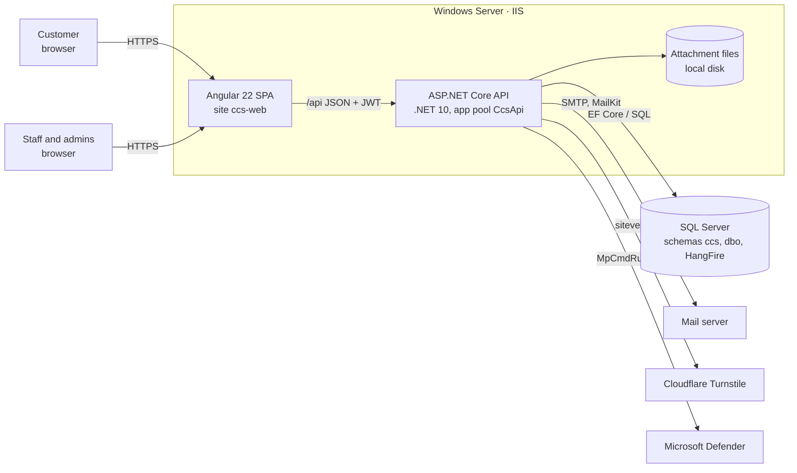

# 01 — System Overview

> Scope: the repository `akodira/css-v2` at commit `18b46e2` (main, November 2026).
> This document set describes what is **implemented** in the repository. Anything only stated in older documents
> is marked as such. File paths are relative to the repository root.

## 1. What CCS is

CCS v2 (AZKA Customer Care System) is a ticketing system for customer support. Customers open tickets about
problems. Staff work them in a console. Administrators shape the catalog, the people structure, the
service levels and the system settings. The whole user interface is in English and Arabic (right to left).

It is a new build on Angular, ASP.NET Core and SQL Server that replaces an earlier Next.js + Supabase application.
That older application is referred to in code comments as the behaviour reference. Many C# methods name the
PostgreSQL function they replace (for example `change_ticket_status()` in
`src/Ccs.Domain/Rules/StatusFlow.cs`, `auto_assign_ticket()` in `src/Ccs.Application/Tickets/TicketService.cs`).

## 2. Users and roles

Roles are stored in `ccs.roles` / `ccs.user_roles` and defined in `src/Ccs.Domain/Codes.cs` (`RoleCode`).

| Role | Main area of the app | What they do |
|---|---|---|
| `customer` | `/:locale/tickets…` | Opens tickets, replies, confirms or reopens, cancels, gives feedback |
| `agent` | `/:locale/console…` | Works tickets: reply, internal note, status, assignment |
| `team_leader` | console + team pages | Agent work plus team view and decisions |
| `management_viewer` | console (read) + reports | Read-only staff view and reports |
| `admin` | `/:locale/admin…` | Full system administration |

On top of the role, a staff member has an **account type** (`ccs.account_types`) that carries a set of
**permissions** (`Permission` in `src/Ccs.Domain/Codes.cs`, 19 assignable) and a **scope level**
(system / organization / branch). This allows organization admins and branch admins who manage only
their own place. See [06-Security-Architecture](06-Security-Architecture.md).

## 3. Main capabilities (implemented)

| Area | Implemented in |
|---|---|
| Sign-in by email or phone, email sign-in codes, TOTP two-step, password reset by code, registration with email check and approval | `src/Ccs.Infrastructure/Identity/AuthService.cs`, `src/Ccs.Api/Controllers/AuthController.cs` |
| Account lockout policy, sessions and devices, password history, required two-step, longest sign-in | `LockoutService.cs`, `AccountSecurity.cs`, `SettingsController.Security*.cs` |
| Organizations (tree), branches, teams, team kinds, staff placements and scopes | `AdminController.cs`, `PeopleController*.cs` |
| Catalog: ticket types, categories, sub-categories, priorities, custom fields; a separate catalog per place | `CatalogAdminController*.cs`, `src/Ccs.Application/Tickets/PlaceCatalog.cs` |
| Tickets: create, reply/note, status, assign, priority, category change, escalation, duplicate/spam, cancellation requests, feedback, follow-up links, attachments | `TicketService.cs`, `TicketLifecycleService.cs`, `AttachmentsController.cs` |
| Editable status flow, several flows, custom statuses, closure reasons | `ContentAdminController*.cs`, `src/Ccs.Domain/Rules/FlowRules.cs` |
| SLA with business calendars and holidays, warnings, breaches, pause/resume, reopen cycles | `src/Ccs.Application/Sla/SlaService.cs`, `src/Ccs.Domain/Rules/SlaClock.cs` |
| Timed lifecycle: reminders, auto-close, password expiry warnings | `src/Ccs.Application/Sla/LifecycleService.cs` |
| In-app notifications and queued email with templates per event and language | `NotificationService.cs`, `src/Ccs.Infrastructure/Email/*` |
| Knowledge base with feedback, canned responses | `ContentAdminController.cs` (`KbController`, `CannedController` classes in the same file) |
| Dashboard, reports, report builder, Excel export, audit log | `ConsoleController.cs`, `ReportsController.cs`, `SimpleXlsx.cs` |
| Branding, menus, home page, email design, system messages | `SettingsController.cs`, `SiteController.cs` |
| One-time import from the old Supabase database | `src/Ccs.Api/SupabaseImport.cs`, `migration/migrate.mjs` |

## 4. Context diagram

## 5. Size of the code base

| Part | Size (tracked files) |
|---|---|
| API controllers | 27 files, 247 HTTP endpoints |
| Domain rules | 14 files in `src/Ccs.Domain/Rules` |
| Angular pages and shared parts | 63 TypeScript files under `src/Ccs.Web/src/app` |
| Translations | `en.json` and `ar.json`, about 4,960 lines each |
| Database | 70 tables (63 in `ccs`, 7 Identity tables in `dbo`) plus Hangfire's own schema |
| Tests | 132 xUnit tests and theories in `tests/Ccs.Tests` (several theories run many cases); 28 Playwright specs in `tests/e2e/specs` |

## 6. Implemented vs. stated only

`README.md` contains a "Status by build stage" table written early in the project. It no longer matches the code:
it says the .NET code "has not been compiled yet" and that admin screens are "not started". Today the
solution builds in CI, the admin screens exist, and reports, KB, audit, escalation, cancellation and uploads
are implemented. **Treat the code and these documents as current; the README status table is outdated.**

Items that are **stated but not verified as implemented** are listed in
[10-Technical-Risks-and-Recommendations](10-Technical-Risks-and-Recommendations.md#6-documentation-drift).

## 7. Document map

| # | Document |
|---|---|
| 02 | [System Architecture](02-System-Architecture.md): layers, components, request path |
| 03 | [Frontend Architecture](03-Frontend-Architecture.md) |
| 04 | [Backend Architecture](04-Backend-Architecture.md) |
| 05 | [Database Architecture](05-Database-Architecture.md) |
| 06 | [Security Architecture](06-Security-Architecture.md) |
| 07 | [API and Integrations](07-API-Integration.md) |
| 08 | [Ticket Workflow](08-Ticket-Workflow.md) |
| 09 | [Deployment Architecture](09-Deployment-Architecture.md) |
| 10 | [Technical Risks and Recommendations](10-Technical-Risks-and-Recommendations.md) |
