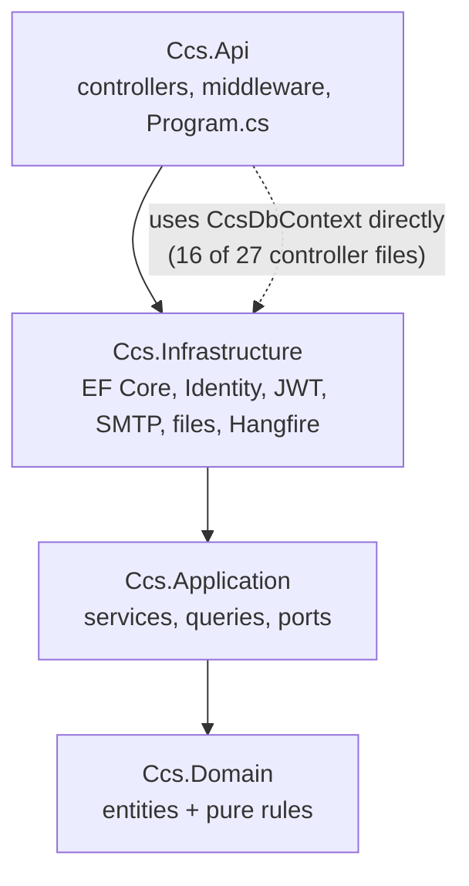
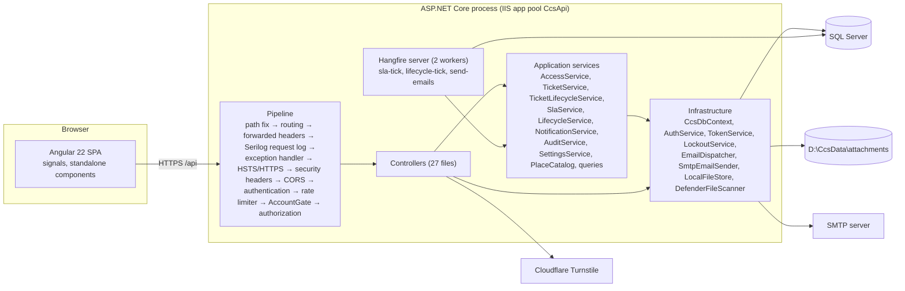
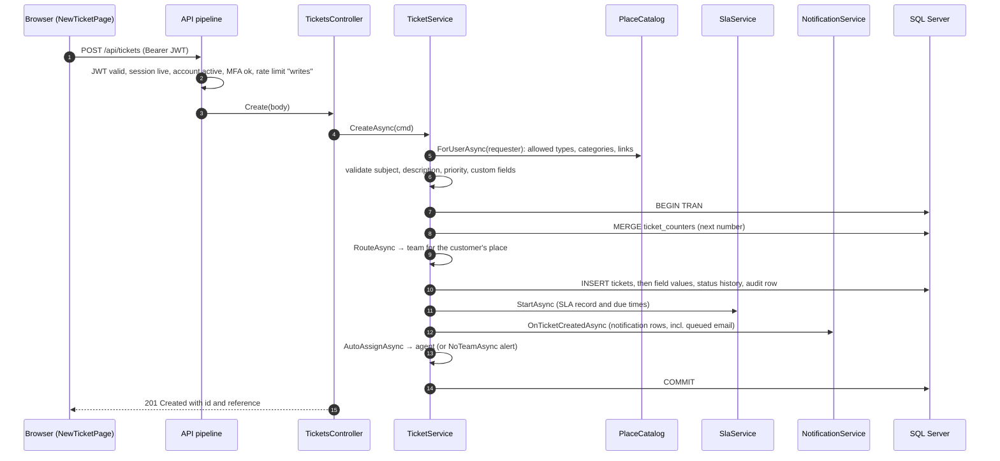

# 02 — System Architecture

## 1. Architectural style

CCS v2 is a **modular monolith**: one Angular single-page application and one ASP.NET Core process,
backed by one SQL Server database. There are no separate services, message brokers or caches outside the
process. Background work (SLA, lifecycle, email) runs **inside the API process** through Hangfire.

The .NET side follows a **layered "clean architecture" layout** with four projects
(`Ccs.slnx`, shared settings in `Directory.Build.props`: `net10.0`, nullable enabled):

| Project | Depends on | NuGet packages (from the `.csproj`) | Holds |
|---|---|---|---|
| `src/Ccs.Domain` | – | none | Entities (`Entities/*.cs`), codes (`Codes.cs`), pure rules (`Rules/*.cs`) |
| `src/Ccs.Application` | Domain | `Microsoft.EntityFrameworkCore`, `FluentValidation`, logging abstractions | Use-case services, queries, the `ICcsDbContext` abstraction and other ports (`Abstractions/Interfaces.cs`) |
| `src/Ccs.Infrastructure` | Application | EF Core SQL Server, Identity EF, BCrypt.Net-Next, MailKit, Hangfire, `System.IdentityModel.Tokens.Jwt`, Newtonsoft.Json | `CcsDbContext`, Identity and tokens, email, files, Defender scan, jobs, Data Protection key ring |
| `src/Ccs.Api` | Infrastructure (and through it the others) | JwtBearer, Swashbuckle, Serilog, Npgsql, HealthChecks.SqlServer | Controllers, middleware, `Program.cs`, installer commands (`AdminSetup.cs`, `SupabaseImport.cs`) |

### Notes on how the layering is applied

- **The Domain is pure.** `src/Ccs.Domain/Rules` contains only static, database-free logic: `StatusFlow.Evaluate`,
  `AccessRules`, `BusinessCalendar`, `SlaClock`, `LockoutRules`, `TeamRouting`, `TicketTimers`, `FlowRules`,
  `FileSignature`, `Formats` and others. These have most of the unit tests (`tests/Ccs.Tests/Domain`).
- **The Application layer is not persistence-ignorant.** `ICcsDbContext` exposes EF Core `DbSet<T>` properties,
  and services use LINQ with EF Core operators (`AsNoTracking`, `ExecuteUpdateAsync`, transactions).
  It is an abstraction over the context, not a repository pattern.
- **Many controllers bypass the Application layer.** 16 of the 27 controller files take `CcsDbContext` in their
  constructor and query or change data themselves (for example `AdminController`, `SettingsController`,
  `CatalogAdminController`, `PeopleController`, `ReportsController`). Ticket work goes through services
  (`TicketsController` → `TicketService`; `TicketLifecycleController` → `TicketLifecycleService`).
  Administration and configuration logic mostly lives in controllers.

## 2. Runtime components

The pipeline order is taken from `src/Ccs.Api/Program.cs` lines 101–146.

## 3. Cross-cutting design patterns found in the code

| Pattern | Where | Notes |
|---|---|---|
| Dependency injection with scoped services | `Infrastructure/DependencyInjection.cs`, `Application/DependencyInjection.cs` | Almost everything is `Scoped`; `LocalFileStore`, `DefenderFileScanner`, `IClock` are singletons |
| Single authorization service | `Application/Access/AccessService.cs` | Builds an `AccessContext` once per request; `VisibleTickets()` is the list filter; `RequireTicketAsync` for single tickets |
| Pure rules + parity test | `Domain/Rules/AccessRules.cs` and `AccessService.VisibleTickets` | `tests/Ccs.Tests/Application/AccessParityTests.cs` checks the in-memory and SQL versions agree |
| Typed exceptions → RFC 7807 | `Application/Common/Errors.cs`, `Api/Middleware/Web.cs` (`AppExceptionHandler`) | `ForbiddenException`, `ValidationFailedException`, `ConflictException`, `RateLimitedException`, `AuthError` map to status codes |
| Optimistic concurrency | `ccs.tickets.row_version` (`rowversion`) + `IsRowVersion()` in `CcsDbContext` | `DbUpdateConcurrencyException` becomes a 409 in `TicketService` |
| Outbox-like email queue | `ccs.notifications` rows with `channel = 'email'`, claimed by `EmailDispatcher` | Lease (`locked_until`), `attempts`, `READPAST`; see [07](07-API-Integration.md) |
| Settings as key/value rows | `ccs.app_settings` read by `SettingsService` | Cached per request only |
| Clock abstraction | `IClock` / `SystemClock` | Used for testable time maths (SLA, lockout) |
| Audit trail | `AuditService.Write` → `ccs.audit_logs` | Called by controllers and services on changes |

## 4. Main request path (create a ticket)

## 5. Background processing

`CcsJobs.Schedule` (`src/Ccs.Infrastructure/Jobs/CcsJobs.cs` lines 44–48) registers three recurring Hangfire jobs.
They run only when `Jobs:Enabled` is true (`Program.cs` line 31, `DependencyInjection.cs` line 85).

| Job id | Schedule | Calls |
|---|---|---|
| `sla-tick` | every minute | `SlaService.TickAsync` |
| `lifecycle-tick` | every 15 minutes (`*/15 * * * *`) | `LifecycleService.TickAsync` |
| `send-emails` | every minute | `EmailDispatcher` |

Hangfire storage is SQL Server (schema `HangFire`, created by Hangfire itself, `PrepareSchemaIfNecessary = true`).
The dashboard is mapped at `/api/jobs` and only answers loopback requests (`LocalOnlyDashboardFilter`).

## 6. Key architectural decisions visible in the code

| Decision | Evidence |
|---|---|
| Replace PostgreSQL row-level security and triggers with C# services | `AccessService` header comment; `docs/DB-NOTES.md` |
| Keep the old status names and behaviour | `TicketStatus` comment "same as the PostgreSQL enum"; methods named after old SQL functions |
| Same site by default, separate API site optional | `apiBase` in `src/Ccs.Web/src/app/core/api-base.ts`; IIS path fix in `Program.cs` lines 99–109; installer `-ApiHostName` path |
| No EF retry strategy | `Infrastructure/DependencyInjection.cs` lines 26–28: retrying strategies reject explicit transactions; SQL is local |
| Secrets in the database, protected by a machine certificate | `Infrastructure/Security/KeyRing.cs`, `ccs.data_protection_keys`, installer step "Key certificate" |
