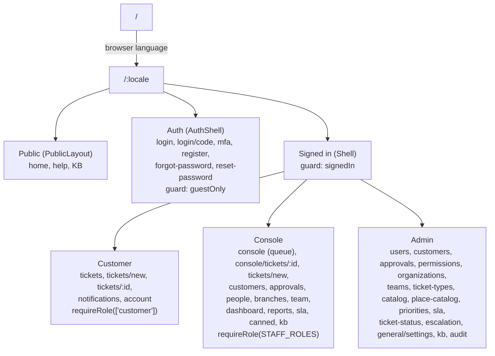
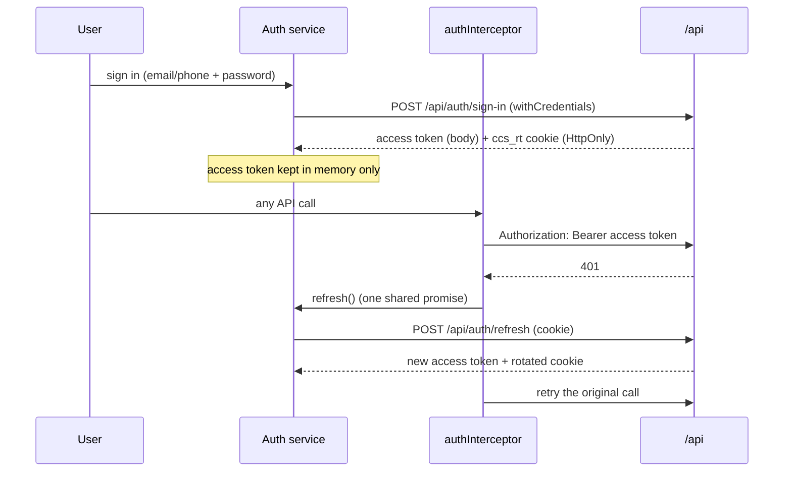

# 03 — Frontend Architecture

## 1. Stack (from `src/Ccs.Web/package.json`)

| Concern | Choice |
|---|---|
| Framework | Angular `^22.2` (common, core, forms, router, platform-browser) |
| Build | `@angular/build` (esbuild application builder), TypeScript `~6.0` |
| Styling | Tailwind CSS 4 through `@tailwindcss/postcss`, tokens in `src/Ccs.Web/src/styles.css` |
| Fonts | IBM Plex Sans and IBM Plex Sans Arabic (self-hosted with `@fontsource`) |
| Messages | `intl-messageformat` behind a custom `I18n` service |
| Other | `qrcode` (TOTP enrolment QR), `rxjs ~7.8` |
| Tests | `vitest` and `jsdom` are installed, but the repository has **no `*.spec.ts` unit tests**. UI is covered by Playwright specs in `tests/e2e` |

Bundle budget (`angular.json`): initial warning at 950 kB, error at 1 MB. The production build currently reports a
warning just over 950 kB (see [10](10-Technical-Risks-and-Recommendations.md)).

## 2. Application structure

```
src/Ccs.Web/src/app/
  app.config.ts        providers: HttpClient (fetch + interceptors), router, app initializer
  app.routes.ts        all routes under /:locale (en | ar)
  core/                api-base.ts, auth.ts, i18n.ts, api.ts (SiteService, TicketsApi), admin-api.ts (AdminApi)
  layout/layouts.ts    PublicLayout, Shell (signed-in frame with side menu), Footer, Coming
  pages/               auth/, tickets/ (customer), console/ (staff), admin/, account, help
  shared/              UI parts: ui.ts (Card, Alert, TextField, StatusBadge, SlaChip…), rich-editor, charts,
                       live-search, otp-input, turnstile, phone, files, tiles (icon set)…
  help/                in-app help content
```

Patterns used throughout:

- **Standalone components only**, with templates inline in the `.ts` files. There are no NgModules.
- **Signals** for state (`signal`, `computed`). Services are `providedIn: 'root'` singletons. There is no NgRx or other store library.
- **Large page files that hold several components.** Examples: `pages/admin/settings-pages.ts` (1,842 lines),
  `pages/admin/people-pages.ts` (1,618), `pages/admin/catalog-pages.ts` (1,155).
- **Fixed strings in templates.** Shared icon markup is kept as string constants (`shared/tiles.ts`) and placed
  into templates with `${…}`, because Angular templates must be static strings.

## 3. Start-up

`app.config.ts`:

1. `provideHttpClient(withFetch(), withInterceptors([authInterceptor, apiBaseInterceptor]))`.
2. `provideRouter(routes, withComponentInputBinding(), withInMemoryScrolling(...), withNavigationErrorHandler(reloadOnMissingPageFile))`.
   After a new release, a missing lazy chunk triggers a full reload, at most once a minute.
3. `provideAppInitializer`: `loadApiBase()` reads `/config.json`, which the installer writes when the API is a
   separate site. Then `SiteService.load()` (branding, rules) and `Auth.restore()` (session from the refresh
   cookie) run in parallel.

## 4. Routing and screens

All routes sit under `:locale` (guarded by `localeGuard`). The root redirects to `/ar` or `/en` from the browser language.



- `STAFF_ROLES = ['agent', 'team_leader', 'admin', 'management_viewer']` (`core/auth.ts`).
- 23 routes use `loadComponent` (lazy), 33 use `component` (in the main bundle).
- **Route guards control only what the user sees.** Every rule is enforced again by the API
  ([06](06-Security-Architecture.md)).
- The side menu is built from the database (`ccs.menu_items`, editable by admins) and filtered in
  `layout/layouts.ts` (`GROUP_OF`, `ITEM_ICON`, `ROUTE` maps, and the user's role, permissions and scope level).

## 5. Session handling in the browser (`core/auth.ts`)



- The interceptor reacts to specific `code` values in error responses:
  - `mfaRequired` sends the user to `/mfa`;
  - `mfaSetupRequired` sends them to the account page in setup mode;
  - `suspended` or `pendingApproval` signs them out and returns them to the login page with a reason.
- **Idle sign-out happens in the browser only.** The default is 5 minutes, set from Settings → System. The limit is kept in
  `localStorage` (`ccs.idleLimitMs`), and the last activity is checked again when the app starts.
  The server has no idle timeout; see [06](06-Security-Architecture.md).

## 6. Calling the API

- `core/api.ts`:
  - `SiteService`: public site data, branding URLs, menus.
  - `TicketsApi`: ticket list, detail, options, create, messages, status and similar.
- `core/admin-api.ts`: `AdminApi`, the typed calls for admin and console screens.
- `core/api-base.ts`: `apiUrl()` and `apiBaseInterceptor` add the API address when the API is on its own site.
- Errors are read with `problemOf(err)` (`core/auth.ts`). It understands the API's RFC 7807 body (`code`, `field`).

## 7. Internationalisation

- Locales: `en`, `ar` (`core/i18n.ts`, `LOCALES`). Messages are in `public/i18n/en.json` and `public/i18n/ar.json`
  (the same keys in each file, about 4,960 lines each) and are rendered with the `t` pipe (`TPipe`).
- Arabic sets `dir="rtl"`. Layouts use logical CSS properties (`ms-`, `me-`, `start`, `end`).
- Some content is translated by data, not by files: names in the catalog (`name_en` / `name_ar` columns), email
  templates per locale, and system messages.

## 8. Hosting of the web build

`public/web.config` (copied into the build):

- `spa-fallback` rewrites unknown paths to `/index.html`.
- `html-no-cache` makes HTML files never cached, so new releases load at once.
- Security headers, including a **Content-Security-Policy**: `default-src 'self'`; scripts and frames only from
  self and `https://challenges.cloudflare.com` (Turnstile); `style-src 'self' 'unsafe-inline'`.

A prebuilt copy of the production build is committed in `prebuilt/ccs-web`, stamped in `prebuilt/BUILD.txt`.
It is used for packaging (see [09](09-Deployment-Architecture.md)).

## 9. Observations

| Observation | Impact |
|---|---|
| No component or service unit tests | Front-end regressions are found only by e2e runs or by hand |
| Very large page files with several components each | Harder to review; each lazy chunk contains many screens |
| Initial bundle over the 950 kB warning budget | Slower first load on weak networks |
| Guards rely on `me.roles` from `/api/me`; menu rules repeat permission logic from the API | Two places to keep in step (the API stays authoritative) |
