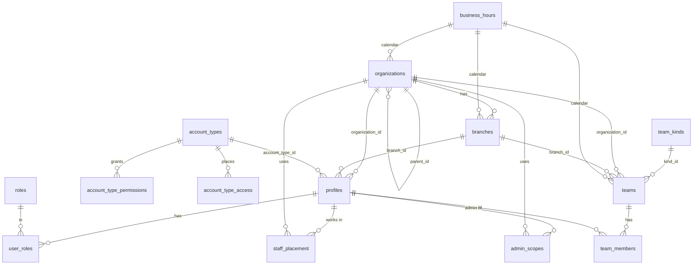
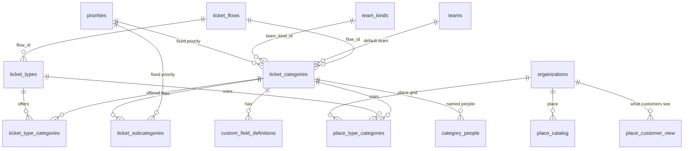
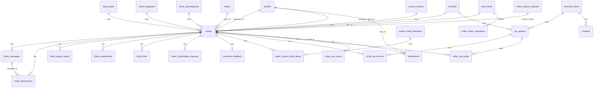

# 05 — Database Architecture

## 1. Platform and scripts

- **SQL Server 2019 or later.** CI installs SQL Server 2022 Developer with Full-Text Search.
- Application schema **`ccs`**. ASP.NET Identity tables are in **`dbo`**. Hangfire creates schema **`HangFire`**
  at start-up (`PrepareSchemaIfNecessary = true`).
- A new database is created by the installer with collation `Latin1_General_100_CI_AS_SC` and
  **`READ_COMMITTED_SNAPSHOT ON`** (row versioning: readers do not block writers).
- There is no ORM migration system: no EF Core migrations and no migrations history table. The schema is managed with
  hand-written T-SQL scripts in `database/`, run by the installer (`deploy/Install-Ccs.ps1`, step "2 database"):

| Script | Content | When the installer runs it |
|---|---|---|
| `01_schema.sql` | 62 tables (55 `ccs`, 7 `dbo` Identity), keys, checks, indexes | New database only (the installer checks for `ccs.tickets` first) |
| `02_seed.sql` | Reference data (roles, statuses, transitions, priorities, defaults) with `IF NOT EXISTS` guards | Every install and update |
| `05_upgrades.sql` | Idempotent upgrades (`IF COL_LENGTH … IS NULL`, `IF OBJECT_ID …`): 9 guarded `CREATE TABLE`s (8 new; `password_history` repeats one from `01`), new columns, keys and indexes | Every install and update |
| `03_fulltext.sql` | Full-text catalog `ccs_ft` and index on `ccs.kb_articles` | Only if Full-Text Search is installed |
| `04_logins.sql` | Windows login `IIS APPPOOL\CcsApi` → user `ccs_api`: `db_datareader`, `db_datawriter`, `EXECUTE`, `CREATE TABLE` (for Hangfire's own schema); `DENY ALTER` on `ccs` and `dbo`; **`DENY UPDATE, DELETE` on `ccs.audit_logs`** (append-only audit) | Every install (database name substituted) |
| `status-flow-defaults.json` | The 25 default status transitions, the same as the seed in `02_seed.sql` | Not run; used by `tests/Ccs.Tests/Domain/StatusFlowTests.cs` |

**Totals:** 70 tables (63 in `ccs`, 7 in `dbo`), about 90 indexes, about 124 foreign keys and about 94 named `CHECK`
constraints across `01` and `05`. There are **no stored procedures, functions, triggers or views**. All database
behaviour from the old PostgreSQL system (triggers, row-level security, functions) moved into C#
(see `docs/DB-NOTES.md`).

## 2. Tables by domain

| Domain | Tables |
|---|---|
| Identity and sign-in | `dbo.AspNetUsers`, `AspNetRoles`, `AspNetUserRoles`, `AspNetUserClaims`, `AspNetUserLogins`, `AspNetUserTokens`, `AspNetRoleClaims`; `ccs.refresh_tokens`, `password_history`, `auth_codes`, `signin_codes`, `signin_code_settings`, `captcha_settings`, `rate_counters`, `data_protection_keys` |
| People and places | `profiles`, `roles`, `user_roles`, `account_types`, `account_type_permissions`, `account_type_access`, `admin_scopes`, `staff_placement`, `organizations` (tree via `parent_id`), `branches`, `teams`, `team_members`, `team_kinds`, `category_people` |
| Catalog | `ticket_types`, `ticket_categories`, `ticket_subcategories`, `ticket_type_categories`, `priorities`, `closure_reasons`, `custom_field_definitions`, `place_catalog`, `place_type_categories`, `place_customer_view` |
| Workflow | `ticket_flows`, `ticket_status_transitions`, `ticket_custom_statuses` |
| Tickets | `tickets`, `ticket_counters`, `ticket_messages`, `ticket_attachments`, `ticket_status_history`, `ticket_assignments`, `ticket_links`, `ticket_cancellation_requests`, `customer_feedback`, `ticket_custom_field_values` |
| SLA and calendars | `sla_policies`, `business_hours`, `holidays`, `ticket_sla_records`, `ticket_sla_cycles`, `ticket_sla_events` |
| Knowledge and replies | `kb_categories`, `kb_articles`, `kb_feedback`, `canned_responses` |
| Notifications | `notifications` (in-app and email queue), `email_templates`, `email_settings` |
| Site and settings | `app_settings` (key/value), `site_settings`, `menu_items`, `system_messages` |
| Audit | `audit_logs` |

## 3. Entity relationships

The diagrams are split by domain for readability. Relationships are taken from the `REFERENCES` clauses in
`01_schema.sql` and from the `ALTER TABLE … FOREIGN KEY` statements in `05_upgrades.sql`.

### 3.1 People, places and access

`profiles.id` matches `dbo.AspNetUsers.Id`: Identity holds the login data, and `profiles` holds the CCS person.

### 3.2 Catalog and place catalog

Ownership: `ticket_types`, `ticket_categories`, `ticket_subcategories` and `team_kinds` have nullable
`organization_id` / `branch_id`. Both null means a **system** item. `place_catalog.item_kind`
(`kind`, `type`, `cat`, `sub`) and `item_id` record which items each place uses. Name uniqueness is per owner
(`UX_*_owner_name_*` indexes in `05_upgrades.sql`).

### 3.3 Tickets, workflow and SLA

## 4. The `tickets` table (from `01_schema.sql` line 480)

| Column | Notes |
|---|---|
| `id uniqueidentifier` | Primary key, **nonclustered** (`PK_tickets`) |
| `seq bigint IDENTITY` | **Clustered** unique index `CX_tickets_seq`. New rows go at the end of the table instead of at random GUID positions, which avoids page splits |
| `reference nvarchar(30)` | Unique (`UQ_tickets_reference`), for example `INC-26-0073`; produced by `CcsDbContext.NextTicketNumberAsync` |
| `subject`, `description` | `CHECK` length 3–200 and 10–10,000 |
| `status nvarchar(20)` | `CHECK` against the 8 built-in statuses |
| `custom_status nvarchar(20)` | Added in `05_upgrades.sql`; FK to `ticket_custom_statuses` |
| `flow_id` | Added in `05_upgrades.sql`; FK to `ticket_flows` |
| `priority` | FK to `priorities.code` |
| `row_version rowversion` | Optimistic concurrency, mapped with `IsRowVersion()` |
| `created_at`, `updated_at`, `resolved_at`, `closed_at` | `datetimeoffset(7)`, defaults `SYSUTCDATETIME()` |

Indexes on `tickets`: `IX_tickets_agent`, `_category`, `_created_by`, `_created` (desc),
`_requester_created`, `_status` (with `INCLUDE`), `_team_status`, `_type`, `_updated` (desc).

## 5. Index and constraint patterns

| Pattern | Examples |
|---|---|
| **Filtered unique indexes** for "one of" rules | `UX_business_hours_default … WHERE is_default = 1`; `UX_sla_active_priority … WHERE is_active = 1`; `UX_cancel_one_pending … WHERE status = 'pending'`; `UX_profiles_phone … WHERE phone IS NOT NULL`; `UX_teams_kind_place … WHERE kind_id IS NOT NULL` |
| **Filtered queue indexes** | `IX_notifications_email_pending … WHERE channel = 'email' AND status = 'pending'`; `IX_notifications_unread … WHERE channel = 'in_app' AND read_at IS NULL` |
| **Persisted computed keys** so a nullable branch can be part of a unique key | `branch_key AS ISNULL(branch_id, '00000000-…') PERSISTED` on `account_type_access`, `admin_scopes`, `staff_placement` |
| Composite "parent + time" indexes for timelines | `IX_messages_ticket (ticket_id, created_at)`, `IX_status_history_ticket`, `IX_assignments_ticket`, `IX_notifications_user (user_id, created_at DESC)`, `IX_audit_entity` |
| Token lookups by hash | `UX_refresh_tokens_hash`, `IX_refresh_tokens_session … INCLUDE (revoked_at, expires_at)` |
| Self-reference guards | `CK_org_not_own_parent` |

**Delete rules.** SQL Server rejects many of the old PostgreSQL `ON DELETE SET NULL` and `CASCADE` rules (multiple paths or cycles),
so those keys are `NO ACTION` and the application deletes or clears rows in order. For example `AdminController`
lines 288–294 delete team memberships, placements, scopes, roles and notifications before deleting a user.
`docs/DB-NOTES.md` lists these rules, but names services (`UserAdminService`, `SlaAdminService`, `KbService`,
`TeamService`) that **do not exist**: the logic is in the controllers.

## 6. Data access patterns

| Pattern | Evidence |
|---|---|
| EF Core LINQ through `CcsDbContext` / `ICcsDbContext`; entities have no navigation properties | joins written explicitly in LINQ (for example `AccessService.BuildContextAsync`) |
| `AsNoTracking()` for reads; `ExecuteUpdateAsync` / `ExecuteDeleteAsync` for set-based writes | `TokenService.RevokeAllAsync`, `AdminController` deletes |
| Explicit transactions for multi-row changes | 26 `BeginTransactionAsync` calls |
| Raw SQL only where EF cannot express the locking | `NextTicketNumberAsync` (`MERGE … WITH (HOLDLOCK)`), email claim (`ROWLOCK, UPDLOCK, READPAST` with a 5-minute lease, `Mail.cs` line 169), ticket counter read (`SettingsController` line 688). All use interpolated, **parameterised** SQL |
| Access filtering inside SQL | `AccessService.VisibleTickets()` builds the `WHERE` from the caller's context; there is no row-level security in the database |
| Settings as rows | `ccs.app_settings` read once per request by `SettingsService` |
| Secrets at rest | SMTP password and captcha secret encrypted with ASP.NET Data Protection; keys in `ccs.data_protection_keys`, themselves encrypted with the certificate `CN=CCS Data Protection` |

## 7. Observations

| Observation | Detail |
|---|---|
| The full-text index is not used | `03_fulltext.sql` indexes `kb_articles`, but `KbController` searches with `.Contains()` (SQL `LIKE '%…%'`), which cannot use that index |
| Status `CHECK` and custom statuses | `CK_tickets_status` still allows only the 8 built-in values; custom statuses are a second column, so a ticket's "real" status is the pair (`status`, `custom_status`) |
| No schema version record | Upgrades are guarded by existence checks; nothing records which upgrade level a database has |
| No retention or clean-up jobs | `CcsJobs` has only SLA, lifecycle and email jobs; `notifications`, `audit_logs`, `refresh_tokens` and `rate_counters` grow without a purge |
| Hot-path query count | Each request rebuilds the access context from several tables (see [04](04-Backend-Architecture.md)); no caching between requests |
| Audit log without a time-only index | `audit_logs` is indexed by actor and by entity, not by `created_at` alone, which the audit page filters on |
