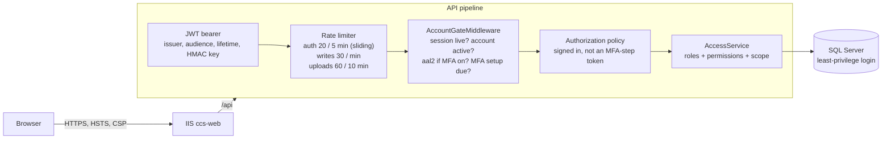
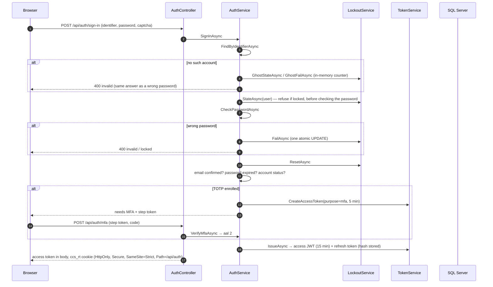
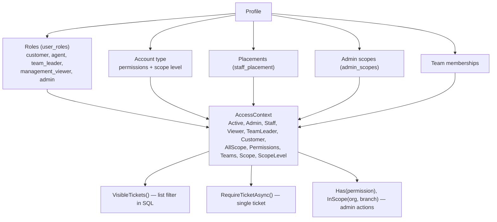

# 06 — Security Architecture

This document describes the security controls **as implemented**. A separate audit
(`SECURITY_AUDIT_REPORT.md`, written against commit `ed4c10c`) lists findings. Section 9 below shows which of
them have code fixes in later commits.

## 1. Overview

## 2. Identity and authentication

| Item | Implementation |
|---|---|
| User store | ASP.NET Core Identity (`AppUser : IdentityUser<Guid>`, `IdentityParts.cs`) with EF stores in `dbo.AspNet*`; unique email; **confirmed email required** |
| Password hashing | `BcryptCompatiblePasswordHasher`: checks bcrypt hashes imported from the old system and re-hashes them with Identity's own algorithm after a successful sign-in |
| Password rules | `SettingsPasswordValidator`: length and character rules from Settings; Identity's own fixed rules are switched off (`DependencyInjection.cs` lines 39–41) |
| Password history and expiry | `AccountSecurity.CheckReuseAsync` / `RememberAsync` (`ccs.password_history`); expired passwords cannot sign in (`passwordExpired`); `LifecycleService.PasswordExpiryTickAsync` warns at 7, 4 and 1 days |
| Sign-in identifiers | Email or Egyptian mobile number (`AuthService.FindByIdentifierAsync`, `Domain/Rules/Formats.cs`) |
| Other sign-in paths | Email sign-in code (`signin-code`, `signin-code/verify`); password reset by emailed code |
| Registration | `register` → email code confirmation → `pending_approval` if approval is required; approvers chosen by `AccountApprovers` (branch admin, then org admin, then system admins) |
| Captcha | Cloudflare Turnstile through `CaptchaVerifier`, configured in Settings; secret stored encrypted |

### 2.1 Sign-in sequence

## 3. Tokens and sessions

| Item | Value / behaviour | Source |
|---|---|---|
| Access token | JWT HMAC-SHA256, 15 minutes (`Jwt:AccessMinutes`), validated for issuer, audience, lifetime and key; clock skew 30 s | `Program.cs` 46–58, `TokenService` |
| Signing key | `Jwt:SigningKey`, base64, at least 32 bytes or start-up fails; the installer creates 48 random bytes as an app-pool environment variable | `Program.cs` 41–43, `Install-Ccs.ps1` line 218 |
| Claims | `sub`, `aal` (1 or 2), `sid` (session), `purpose` (`mfa` for the step token), roles | `CcsClaims` in `TokenService.cs` |
| Refresh token | Random value, stored as SHA-256 hash in `ccs.refresh_tokens`; 14 days (`Jwt:RefreshDays`); **rotated on every use** | `TokenService.IssueAsync`, `ConsumeAsync` |
| Reuse detection | A rotated (replaced) token used again revokes every session of the user | `TokenService` lines 90–101 |
| Session end takes effect at once | Every request checks `sid` against live refresh tokens (`SessionLiveAsync`), so signing a device out ends it before its access token expires | `AccountGateMiddleware` |
| Longest sign-in | Per-role maximum session time from Settings; a refresh cannot extend past it | `AccountSecurity.MaxSessionAsync`, `TokenService` line 75 |
| Idle timeout | **Browser only** (default 5 minutes, `core/auth.ts`); the server has no idle check | `src/Ccs.Web/src/app/core/auth.ts` |
| Session management | Own devices (`/api/me/sessions`), admin "end session" and "sign out everywhere" (`SettingsController.SecurityExtras.cs`) | |
| New device alerts | After sign-in, an unknown browser/system is written to the audit log and optionally emailed | `AccountSecurity.AfterSignInAsync` |

## 4. Multi-factor authentication

- TOTP enrolment (`mfa/enroll`, `mfa/enroll/verify`; QR code made in the browser with `qrcode`) and disable
  (`mfa/disable`, needs a code). An admin can reset it (`/api/admin/users/{id}/reset-mfa`).
- **Enforcement on every request:** if the user has two-step on and the token is not `aal` 2, the gate answers
  `401 mfaRequired`. `AccessService` makes the same check (`mfaOk`).
- **Required two-step by role:** `AccountSecurity.MfaDueAsync`. Once the grace period passes, only `/api/me`,
  `/api/me/sessions`, `/api/auth/*` and `/api/site/*` work, and everything else answers `403 mfaSetupRequired`.

## 5. Account lockout

- Policy: `LockoutPolicy` (`Domain/Rules/Lockout.cs`), set in Settings → Security. The defaults are 5 attempts in a 15-minute
  window, a 30-minute lock, the count resets after 15 minutes, automatic unlock, and notices to the user and to admins.
- Counting rule: `LockoutRules.AddFailure`. For real accounts the database applies the same rule in a single `UPDATE`,
  so failed attempts made at the same moment are all counted. For unknown addresses the same rule runs in memory ("ghost"
  counters), so the answers do not show whether an account exists.
- A locked account is refused **before** the password is checked.
- Admin screens: locked accounts list and unlock with a reason (`SettingsController.Security.cs`).

## 6. Authorization model

- **Permissions** (`Permission` in `Codes.cs`): `reply`, `resolve`, `close`, `change_category`, `assign_self`,
  `assign_others`, `view_unassigned`, `view_others`, `all_teams`, `reports_own`, `reports_all`, `export`,
  `manage_canned`, `customers_view`, `customers_manage`, `approve_customers`, `manage_kb`, `manage_catalog`,
  `manage_settings`. Two more are granted by flags only: `create_for_customer`, `manage_users`.
- `AccessRules.EffectivePermissions`: admins get everything. Customers get **no** staff permissions (audit fix C-01).
  Staff without a type get the legacy full set (`NoTypeDefault`).
- **Scope:** placements and admin scopes expand down the organization tree (`OrgTreeAsync`, `WithChildren`).
  Without them, the scope comes from `account_type_access`. All-scope staff see every organization.
- **Ticket visibility** (`VisibleTickets`, mirrored by `AccessRules.CanAccessTicket` and checked by `AccessParityTests`):
  - the requester always sees their own tickets;
  - if shared access is on, a customer sees the tickets of the whole organization;
  - staff see a ticket when all of these hold: it is in their scope, it is in their teams (or they have `all_teams`, or are viewers),
    and they have `view_unassigned` / `view_others` as needed. Tickets assigned to them are always visible;
  - internal notes are only for internal (staff) users.
- **The API does not use `[Authorize(Roles=…)]` for business rules.** Controllers call `AccessService` and the private
  helpers `Need(permission)` / `Covers(...)`. A missing check is therefore a code-review matter, not a framework guarantee.
- Organization and branch admins (`ScopeLevel` organization/branch) can manage only their own places, for example in
  `PlaceScope.Covers` (place catalog) and `AdminScopes` checks in `PeopleController`.

## 7. Transport, browser and API hardening

| Control | Where |
|---|---|
| HTTPS redirect, HSTS 365 days with subdomains (non-development) | `Program.cs` 95, 119–120 |
| `X-Content-Type-Options`, `Referrer-Policy`, `X-Frame-Options: DENY` | `Program.cs` 121–127 |
| Content-Security-Policy and HTML no-cache | `src/Ccs.Web/public/web.config` |
| CORS only for a separate API site, single origin, with credentials | `Program.cs` 83–85, 128 |
| Rate limits per user (or IP when anonymous) | `Program.cs` 70–80; business limits in the database (for example 15 tickets per hour per customer, `TicketService.CreateAsync`) |
| Swagger only in Development or when `Swagger:Enabled` | `Program.cs` 134–138 |
| Hangfire dashboard only from loopback | `LocalOnlyDashboardFilter` |
| Errors without internal detail | `AppExceptionHandler` |

## 8. Data protection

| Asset | Protection |
|---|---|
| Database access | Windows login of the app pool (`IIS APPPOOL\CcsApi`), no password; `db_datareader`/`db_datawriter`; `DENY ALTER` on `ccs`, `dbo`; `DENY UPDATE, DELETE` on `ccs.audit_logs` (`04_logins.sql`) |
| SMTP password, captcha secret | ASP.NET Data Protection; key ring in `ccs.data_protection_keys`, encrypted with certificate `CN=CCS Data Protection` in `LocalMachine\My` (`Infrastructure/Security/KeyRing.cs`) |
| Refresh tokens, codes | Stored as hashes |
| Attachments | Outside the web root (`FileStore:Root`); path traversal guard; extension allow-list (`AttachmentsController.Mime`); **magic-byte check** (`FileSignature.Matches`); per-ticket and per-user-per-day quotas; Defender scan that **refuses the file if the scanner fails** (`DefenderFileScanner`, audit fix M-05); always downloaded as attachments, never shown inline |
| Audit trail | `AuditService` → `ccs.audit_logs`, append-only for the API login |
| Data at rest | No column encryption or TDE is set up by the scripts (backup encryption is an operations matter) |

## 9. Status of the security audit findings

The audit was written at `ed4c10c`. Later commits reference finding IDs in their messages and in code comments:

| Finding | Status in the code | Evidence |
|---|---|---|
| C-01 customers had staff permissions | **Fixed** | commit `8e48c05`; `AccessRules.EffectivePermissions` |
| H-01 scoped staff could take over customers | **Fixed** | commit `16414bf`; `AdminController.Covers`, `RequirePlacementInScope` |
| H-02 no MFA enforcement by role | **Addressed** (required two-step by role) | commit `d055cbf`; `AccountSecurity.MfaDueAsync` |
| M-01, M-02, M-03, L-01, L-02 | **Fixed** | commit `0384cef`; `audit M-01`… comments in code |
| M-05, M-07, L-04, L-05, L-06 | **Fixed** | commit `dd2f742`; `FileSignature`, quotas, fail-closed scan, `DENY` on audit log |
| M-04 sliding 14-day sessions, browser-only idle | **Partly addressed** (longest sign-in per role); server-side idle timeout **not implemented** | `AccountSecurity.MaxSessionAsync` |
| M-06 anonymous rate limit per IP | **Open** (no change found) | `Program.cs` partition key |
| L-03 account enumeration | **Partly addressed** (ghost counters give the same answers for unknown addresses); not re-verified end to end | `LockoutService.Ghost*` |
| L-07 public endpoints return more than needed | **Not verified** | `SiteController` |
| L-08 captcha fails open on a configuration fault | **Open**: when the secret cannot be opened, the check is skipped with a warning; network errors fail closed | `CaptchaVerifier` lines 63–66, 91–95 |
| L-09 parallel refresh in two tabs | **Open** for two tabs (the shared promise covers one tab only) | `core/auth.ts` `refreshing` |
| I-04 `AllowedHosts: "*"` | **Open** | `src/Ccs.Api/appsettings.json` |

"Open" means no code change was found in this review. It does not mean the risk was re-tested.
