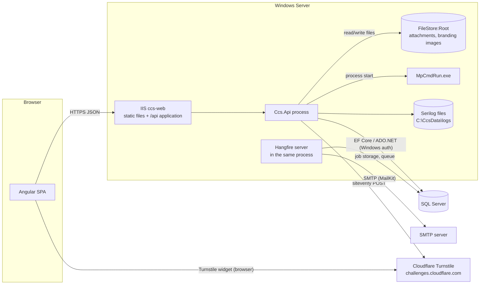
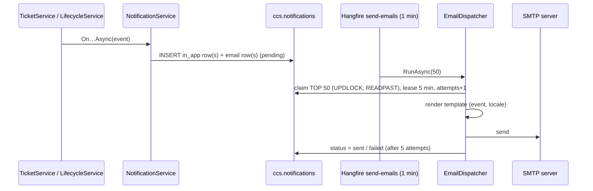

# 07 — API and Integrations

## 1. API conventions

| Convention | Implementation |
|---|---|
| Style | REST-like JSON over HTTPS, attribute routing, all under `/api` |
| JSON | camelCase (`Program.cs` line 39) |
| Identifiers | GUIDs in routes (`{id:guid}`); codes for priorities, statuses, closure reasons (`{code}`) |
| Authentication | `Authorization: Bearer <JWT>`; refresh by HttpOnly cookie `ccs_rt` on `/api/auth/*` only |
| Errors | RFC 7807 ProblemDetails with extra `code` and, for validation, `field` (`AppExceptionHandler`) |
| Rate limits | `[EnableRateLimiting("auth" | "writes" | "uploads")]`; 429 on rejection |
| Versioning | **None** (no version in the path or headers); the API and the SPA are released together |
| Documentation | Swagger / OpenAPI (`Swashbuckle`) with XML comments, **only in Development or when `Swagger:Enabled` is true** |
| Health | `GET /api/health` (SQL Server check from `AspNetCore.HealthChecks.SqlServer`) |

## 2. Endpoint catalogue

There are 247 actions in 25 files that define routes. The anonymous surface is `api/auth/*` (except change-password and MFA
management), `api/site/*` and `/api/health`. Everything else needs a signed-in, active, gate-approved user.

| Area | Route prefix | Actions | Controller file(s) | Examples |
|---|---|---|---|---|
| Sign-in and account | `api/auth` | 14 | `AuthController.cs` | `sign-in`, `mfa`, `refresh`, `sign-out`, `signin-code`, `signin-code/verify`, `register`, `confirm-email`, `forgot-password`, `reset-password`, `change-password`, `mfa/enroll`, `mfa/enroll/verify`, `mfa/disable` |
| Public site and me | `api/site`, `api/me` | 11 | `SiteController.cs` (`SiteController`, `MeController`) | `GET api/site`, `branding/{name}`, `email-assets/{name}.png`, `menus`, `signup-options`; `GET/PUT api/me`, `me/sessions` |
| Tickets (core) | `api/tickets` | 9 | `TicketsController.cs` | `GET` list, `summary`, `options`, `{id}`; `POST` create, `{id}/status`, `{id}/messages`, `{id}/assign`, `{id}/priority` |
| Ticket lifecycle | `api/tickets/{id}` | 14 | `TicketLifecycleController.cs` | `lifecycle`, `category`, `escalate`, `escalate-to`, `duplicate`, `spam`, `staff-fields`, `messages/{messageId}` (PUT/DELETE), `cancel`, `cancel/withdraw`, `cancellations/{requestId}`, `feedback`, `follow-up` |
| Attachments and helpers | `api/tickets/...` | 4 | `AttachmentsController.cs`, `TicketStaffController.cs`, `CreatableCustomersController.cs` | upload, download, staff list for assignment, customers a staff member can create tickets for |
| Console | `api/console` | 15 | `ConsoleController.cs`, `PeopleController.cs`, `PeopleController.Branches.cs`, `CustomerProfileController.cs` | `counts`, `customers`, `teams`, `badges`, `dashboard`, `people`, `branches`, `customers/{id}` |
| Reports and audit | `api/reports`, `api/admin/audit`, `api/console/my-team` | 8 | `ReportsController.cs` | `summary`, `options`, `builder`, `export` (xlsx), `sla` |
| Users and places | `api/admin` | 49 | `AdminController.cs`, `PeopleController*.cs`, `CustomerProfileController.cs` | users, approvals, account types, organizations, branches, staff, roles, placements, scope, teams, team kinds, category people, setup |
| Catalog and SLA | `api/admin` | 39 | `CatalogAdminController*.cs` | `catalog`, ticket types, categories, sub-categories, priorities, `priorities-mode`, custom fields, `sla/{priority}`, business hours, holidays, calendar assignments, `place-catalog/*` |
| Workflow and content | `api/admin`, `api/kb`, `api/canned` | 33 | `ContentAdminController*.cs` | `status-flow`, `status-labels`, `flows`, `flow-choice`, `custom-statuses`, `closure-reasons`, `escalation`, KB categories and articles, canned responses; `GET api/kb`, `kb/suggest`, `kb/popular`, `kb/{slug}`, `kb/{slug}/feedback` |
| Settings and security | `api/admin/settings` | 49 | `SettingsController*.cs` | branding, footer, home, menus, email (SMTP, design, test), templates per event and locale, messages, uploads, system, ticket number, phone, routing, registration, captcha, sign-in codes, handover, `security/locked`, `security/unlock`, `security/mfa`, `security/sessions`, `security/report.xlsx` |
| Notifications | `api/notifications` | 3 | `NotificationsController.cs` | list, `{id}/read`, `read-all` |

## 3. How the components talk to each other

All communication is synchronous HTTP or in-process calls. There is no message broker. The only asynchronous
hand-off is through database tables: queued email rows in `ccs.notifications`, Hangfire's own job tables, and the
SLA and lifecycle "tick" jobs that scan tickets.

## 4. External integrations

### 4.1 SMTP email (implemented)

| Aspect | Detail |
|---|---|
| Library | MailKit `SmtpClient` (`SmtpEmailSender`, `Mail.cs` line 23) |
| Configuration | `ccs.email_settings` set in Admin → Settings → Email: host, port, security (`ssl` → SslOnConnect, `none`, otherwise StartTLS), user name, password (encrypted with Data Protection) |
| Templates | `ccs.email_templates` per event and locale, defaults in `Infrastructure/Email/email-defaults.json`, rendered by `TemplateMailer` / `EmailRenderer` (HTML and text frame, safe Markdown) |
| Queue | `NotificationService` writes rows with `channel = 'email'`, `status = 'pending'` |
| Sending | `EmailDispatcher.RunAsync(batch = 50)`, called every minute by the `send-emails` job; claims rows with `UPDLOCK, READPAST`, 5-minute lease, `MaxAttempts = 5`, then `sent` or `failed` with `last_error` |
| Direct sends | Account emails (sign-in, reset and confirmation codes) are sent at once by `AuthService` through `IEmailSender`; the admin test email by `SettingsController` |

Notification events (`NotificationEvent` in `Codes.cs`) include `ticket_created`, `ticket_assigned`, `agent_reply`,
`customer_reply`, `status_changed`, `priority_changed`, `sla_warning`, `sla_breach`, `ticket_resolved`,
`ticket_closed`, `ticket_reopened`, `ticket_escalated`, account approval events, customer reminders and the
pending-internal reminder.

### 4.2 Cloudflare Turnstile (implemented, optional)

- Browser: `shared/turnstile.ts` renders the widget. The CSP allows `https://challenges.cloudflare.com`.
- Server: `CaptchaVerifier.RequireAsync` posts to `https://challenges.cloudflare.com/turnstile/v0/siteverify`
  through the named `HttpClient` `"captcha"` (10-second timeout).
- Settings: `ccs.captcha_settings`; the secret is encrypted.
- Failure modes: if the network call fails or Cloudflare says no, the check fails (fail closed). If captcha is switched on but the
  secret cannot be opened, the check is **skipped** with a warning (fail open; see [06](06-Security-Architecture.md)).

### 4.3 Microsoft Defender (implemented, optional)

`DefenderFileScanner` runs `MpCmdRun.exe` (path `FileStore:DefenderPath`) on each upload:

| Result | Exit code / condition | Effect |
|---|---|---|
| `clean` | exit 0 | File is stored |
| `infected` | exit 2 | Upload refused |
| `failed` | other exit code, or the scanner does not start or times out | Upload refused with 503 |
| `skipped` | path left empty | Scanning off on purpose, for development |

### 4.4 Local file storage (implemented)

`LocalFileStore` saves files under `FileStore:Root` as `{ticketId}/{fileId}-{safe name}`, with a path traversal
guard (`Full()`). Branding and email images are stored the same way and served by `SiteController`.
There is **no cloud or object storage** abstraction in use. `IFileStore` exists, but its only implementation is the local disk.

### 4.5 Old system import (one-off tooling)

- `src/Ccs.Api/SupabaseImport.cs` runs as `Ccs.Api.exe import-supabase` and uses `Npgsql` to read PostgreSQL.
- `migration/migrate.mjs` (Node) and `migration/copy-files.ps1` (attachments) are the migration tools described in `README.md`.

## 5. Integrations stated but not found

| Statement | Finding |
|---|---|
| README: "Application Request Routing (enable proxy at server level)" and `web.config` "proxies /api to the API site" | The current installer hosts the API as the `/api` IIS application (or as a separate site with CORS); `public/web.config` has no proxy rule. ARR is not needed by the current layout |
| SMS or WhatsApp notifications | Not found (the only channels are `in_app` and `email`) |
| SSO / external identity providers (Azure AD, Google) | Not found; `dbo.AspNetUserLogins` exists only as part of the standard Identity schema |
| Webhooks or public API keys for third parties | Not found |
