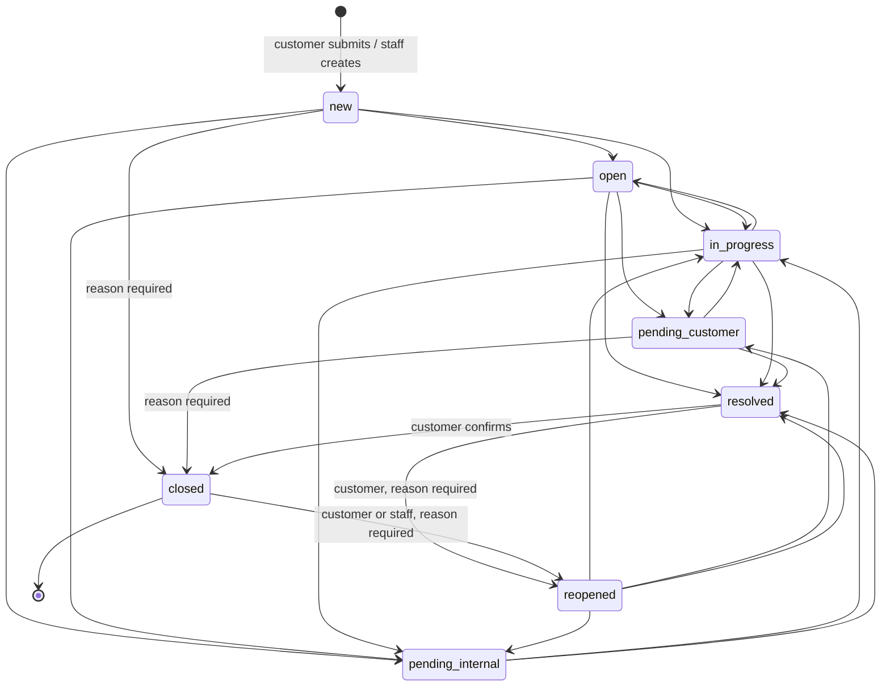
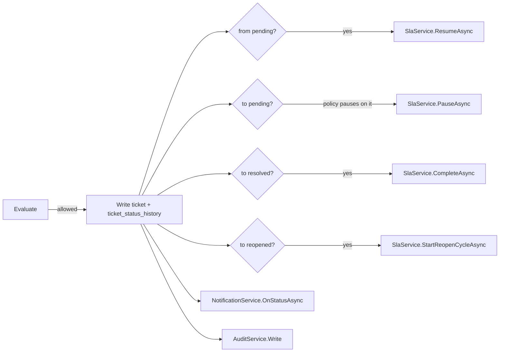
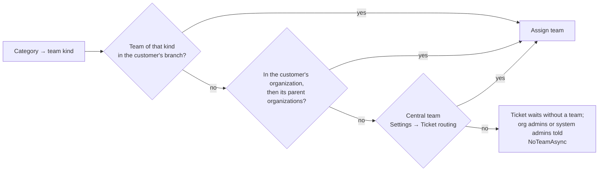
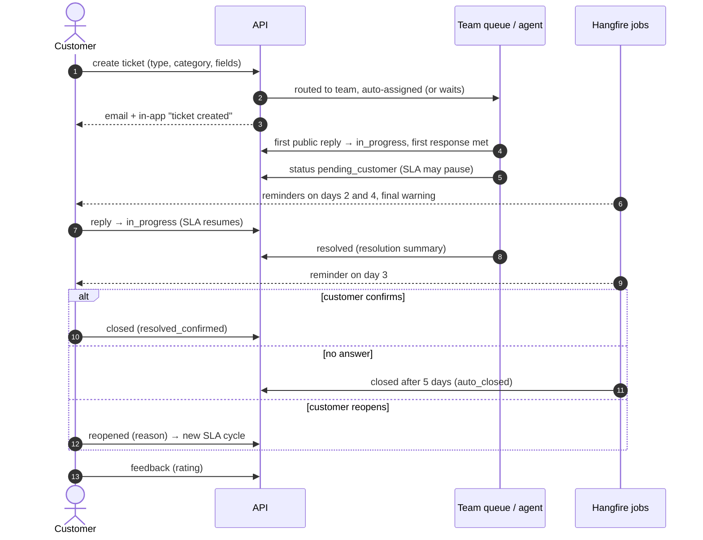

# 08 — Ticket Workflow and Business Rules

## 1. Statuses

Built-in statuses (`TicketStatus` in `src/Ccs.Domain/Codes.cs`; `CK_tickets_status` in `01_schema.sql`):

| Code | Meaning | Group |
|---|---|---|
| `new` | Just submitted | active |
| `open` | Seen, not yet being worked | active |
| `in_progress` | Being worked | active |
| `pending_customer` | Waiting for the customer | pending (SLA may pause) |
| `pending_internal` | Waiting on another team | pending (SLA may pause) |
| `resolved` | Solution given | finished |
| `closed` | Closed with a closure reason | finished |
| `reopened` | Reopened after resolved or closed | active |

**Custom statuses** (`ccs.ticket_custom_statuses`, admin page "Ticket status") behave like one of the built-in
statuses. A ticket stores the built-in status in `status` and the custom code in `custom_status`
(`TicketService.ChangeStatusAsync`: "A custom status is stored as the built-in status it behaves like, plus its own code").

## 2. Status flow (default)

The allowed moves are **data**, not code: `ccs.ticket_status_transitions (from_status, to_status, actor, requires_reason, flow_id)`.
Admins edit them (Admin → Ticket status). They can create several **flows** (`ccs.ticket_flows`), chosen per ticket type or
category (`flow_id` columns) and resolved by `FlowLookup`. The default flow is seeded by `02_seed.sql`, with the same 25 rows as
`database/status-flow-defaults.json`:

All moves are by **staff**, except `resolved → closed`, `resolved → reopened` and `closed → reopened`, which the
**customer** can do. `closed → reopened` is allowed for staff too.

### 2.1 Validation of a status change (`StatusFlow.Evaluate`, `src/Ccs.Domain/Rules/StatusFlow.cs`)

1. The target must be a built-in status or a custom status code.
2. Staff need `resolve` to set `resolved` and `close` to set `closed`.
3. A row `(current, target, actor)` must exist in the flow table.
4. If the row says `requires_reason`, a reason is needed.
5. `resolved`: an optional resolution summary is shown to the customer.
6. `closed`:
   - when the customer closes, the closure reason is always `resolved_confirmed`;
   - when staff close, they must pick an active closure reason, but not one the system reserves for itself
     (`resolved_confirmed`, `auto_closed` and `cancelled`, listed in `ClosureReasonCode.SystemOnly`).
7. A customer reopening is checked against the reopen window (days) and against whether the current closure reason
   allows reopening (`closure_reasons.customer_may_reopen`).

### 2.2 Side effects of a status change (`TicketService.ChangeStatusAsync`)

Each write runs in a transaction. A concurrent change of the same ticket ends in a 409 (`row_version`).

## 3. Creating a ticket (`TicketService.CreateAsync`)

| Step | Rule |
|---|---|
| Who | A customer for themself. Staff with `create_for_customer` for an active customer **in their scope** |
| Rate | 15 tickets per hour per customer (database count); staff creating for customers are exempt |
| Text | Subject 3–200 characters, description 10–10,000 |
| Catalog | The type, category and sub-category must be in what the requester's place offers (`PlaceCatalog.ForUserAsync`), and the type must offer the category (`Links`) |
| Priority | The customer picks only in "customer" priority mode; otherwise the sub-category's or category's fixed priority applies, or staff choose |
| Custom fields | Customers see and fill only fields marked visible to customers; required fields are enforced (`CustomFieldValidator`) |
| Number | `NextTicketNumberAsync` gives the next value from `ticket_counters`; the format comes from Settings → System (for example `INC-26-0073`); a number already in use is skipped |
| History | First `ticket_status_history` row: `null → new`, with the reason "Ticket submitted" or "Created by staff for the customer" |
| SLA | `SlaService.StartAsync` |
| Notify | `NotificationService.OnTicketCreatedAsync` |
| Routing | See section 4 |

## 4. Routing and assignment

### 4.1 Team routing (`TicketService.RouteAsync`, `Domain/Rules/TeamRouting.cs`)

A category names the **kind of team** it needs (`ticket_categories.team_kind_id`). The ticket goes to the first
active team of that kind that matches, in this order:

### 4.2 Agent assignment (`TicketService.AutoAssignAsync`)

- Candidates: active team members with "Gets tickets automatically" on, who are in the customer's place, and, when
  the category names people for this team (`ccs.category_people`), only those people.
- The team's method (or the default from Settings) decides:
  - fewest open tickets;
  - take turns;
  - shared with the team (everyone is told, and the first to take it gets it);
  - the team leader chooses.
- A category can switch automatic assignment off. With no candidate, the ticket waits in the team queue.
- Manual assignment (`AssignAsync`):
  - team leaders and admins can assign anyone;
  - agents can claim unassigned tickets in their own team (`assign_self`) or assign others with `assign_others`.
- Every assignment is recorded in `ccs.ticket_assignments`.

## 5. Conversation rules (`TicketService.AddMessageAsync`)

- Message kinds: `public_reply`, `internal_note`, `system` (`MessageKind`). Internal notes are hidden from customers,
  and so are attachments linked to them.
- Nobody can reply to a `closed` ticket until it is reopened.
- Automatic moves (`TicketTimers.AfterCustomerReply`):
  - when the customer replies on `pending_customer`, the ticket moves to `in_progress`;
  - when the customer replies on `resolved`, it moves to `reopened` if the setting "A customer reply on a Resolved ticket
    reopens it" is on. A flow without `reopened` moves it to `in_progress` instead.
- The first staff reply on a `new` or `open` ticket moves it to `in_progress` and marks the SLA first response
  (`SlaService.MarkFirstResponseAsync`).
- Staff can edit or delete messages (`TicketLifecycleService.EditMessageAsync`, `DeleteMessageAsync`). A delete is a soft delete: the body becomes "-" and `deleted_at` is set.

## 6. Other ticket actions (`TicketLifecycleService`)

| Action | Rule (from code comments, ported from the v1 functions) |
|---|---|
| Change category | `ChangeCategoryAsync`: staff with `change_category` (or admins); not on a closed ticket; the category and sub-category must be valid |
| Escalate up the chain | `EscalateToAsync`: the chain is the branch leader (or the team's leader), then each organization leader up the hierarchy; who can be chosen depends on the escalation mode (off / next / any) set in Admin → Escalation |
| Escalate to admins | `EscalateAsync`: an administrator or the ticket team's leader alerts every administrator |
| Duplicate | `MarkDuplicateAsync(originalReference)`: needs the right to close; adds a `duplicate_of` link and closes this ticket with reason `duplicate` |
| Spam | `MarkSpamAsync`: needs the right to close; closes with reason `spam` |
| Cancellation | `CancelAsync`: before any staff reply the ticket closes at once (reason `cancelled`); afterwards a request is created (`ticket_cancellation_requests`, only one pending at a time: `UX_cancel_one_pending`) and staff decide (`DecideCancellationAsync`); the customer can withdraw it (`WithdrawCancellationAsync`) |
| Feedback | `SubmitFeedbackAsync(rating, comment)` → `customer_feedback` (one per ticket) |
| Follow-up | `LinkFollowUpAsync`: a new ticket continues an older one → `ticket_links` |
| Staff-only fields | `SetStaffFieldsAsync`: custom fields not visible to customers |

## 7. SLA (`SlaService`, `Domain/Rules/SlaClock.cs`, `BusinessCalendar.cs`)

| Element | Implementation |
|---|---|
| Policy | `ccs.sla_policies`: one active policy per priority (`UX_sla_active_priority`); first response and resolution targets; pause on pending customer / internal flags; recipients of warnings and breaches |
| Calendar | `ccs.business_hours` and `holidays`; the calendar comes from the team, branch or organization, else the policy's or the default (`SlaService.TicketCalendarIdAsync`, `CalendarProvider`) |
| Per ticket | `ticket_sla_records` (current state: `on_track`, `due_soon`, `breached`, `paused`, `completed`), `ticket_sla_cycles` (one per reopen), `ticket_sla_events` (warnings and breaches, **deduplicated by a unique index**) |
| Clock | Business-time maths; time while paused is not counted; a priority change recalculates (`ApplyPriorityAsync`) |
| Job | `sla-tick` every minute: `SlaService.TickAsync` fires warning and breach events once per cycle and notifies the roles in the policy |

## 8. Timed lifecycle (`LifecycleService.TickAsync`, job `lifecycle-tick` every 15 minutes)

All days come from `ccs.app_settings`. Defaults are taken from the code:

| Rule | Setting (default) | Effect |
|---|---|---|
| Resolved, no customer response | `auto_close_days` (5) | Closed by the system, reason `auto_closed` |
| Resolved reminder | `resolved_reminder_day` (3) | One reminder before the auto-close |
| Waiting for customer reminders | `pending_reminder_1_day` (2), `pending_reminder_2_day` (4) | `customer_reminder` |
| Waiting for customer, final warning | `pending_final_day` (7) | `customer_final_warning` |
| Waiting for customer, no response | `no_response_close_days` (10) | Closed, reason `no_response` |
| Pending internal | `pending_internal_reminder_days` (3) | Reminds the agent and team leaders every N days; never closes |
| Password expiry | – | Warnings at 7, 4 and 1 days (`PasswordExpiryTickAsync`) |

Day boundaries follow the ticket's business calendar (`WallClock.LifecycleBoundary`).

## 9. End-to-end view

## 10. Implemented vs. not implemented

| Feature | Status |
|---|---|
| Status flow, several flows, custom statuses, closure reasons | Implemented |
| Routing by place, auto-assignment methods, manual assignment | Implemented |
| SLA with calendars, pause/resume, reopen cycles, warnings and breaches | Implemented |
| Reminders and auto-close | Implemented |
| Escalation (chain and to admins), duplicate, spam, cancellation, feedback, follow-up | Implemented |
| Merge of tickets, ticket deletion | **Not implemented** (tickets are never deleted, per `docs/DB-NOTES.md`) |
| Customer satisfaction survey by email | Not found (feedback is given in the app) |
