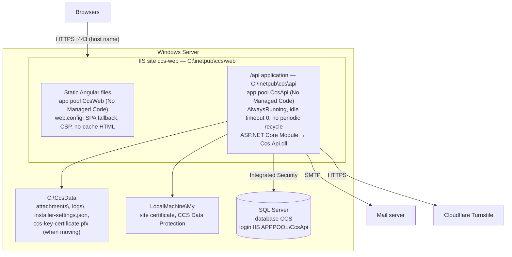
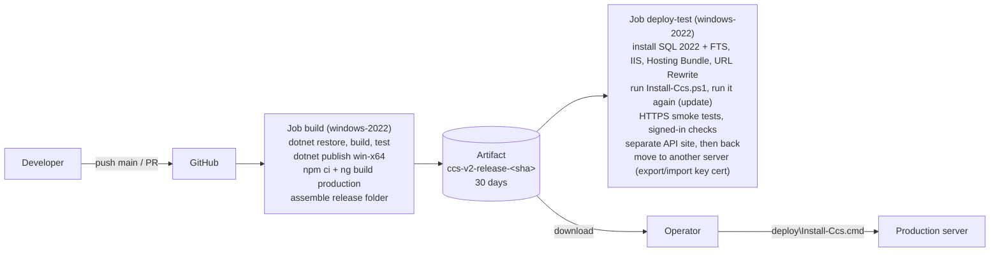

# 09 — Deployment, Configuration and Operations

## 1. Target environment

| Component | Requirement (from `deploy/Install-Ccs.ps1` and CI) |
|---|---|
| OS | Windows Server (CI uses Windows Server 2022) |
| Web server | IIS with URL Rewrite and the ASP.NET Core 10 Hosting Bundle |
| Database | SQL Server 2019+; Full-Text Search optional (KB index); `sqlcmd` on the server |
| Certificates | HTTPS site certificate (or a self-signed test certificate made by the installer); key certificate `CN=CCS Data Protection` |
| .NET | API published `win-x64`, framework-dependent (`dotnet publish … --self-contained false`) |

## 2. Deployment topology

The installer supports two layouts. **Default: one site** (the API is an IIS application at `/api`):

**Optional: separate API site.** With `-ApiHostName`, the installer creates site `ccs-api` (same files, same pool,
its own host name), writes `config.json` with `apiBase` for the SPA, sets `Cors__WebOrigin` and widens the CSP
`connect-src`. CI tests this layout and then moves back to one site.

The default `README.md` description (two sites with an ARR reverse proxy) is **older than the current installer**. The current `public/web.config`
says "no proxy is needed".

## 3. Build and release pipeline

| Item | Detail |
|---|---|
| Workflow | `.github/workflows/ci.yml`; triggers: push to `main`, pull requests, manual; `permissions: contents: read`; concurrency per ref |
| Release content | `ccs-api/`, `ccs-web/`, `database/`, `migration/`, `docs/`, `Install-Ccs.ps1/.cmd`, `Export-KeyCertificate.ps1/.cmd`, `VERSION.txt` (commit and time) |
| Offline build | `Build-Release.ps1` / `.cmd` builds the same package on a Windows machine with only the .NET SDK, using the committed Angular build in `prebuilt/ccs-web` (stamp in `prebuilt/BUILD.txt`) |
| Tests in CI | xUnit unit tests; installer smoke tests through `https://ccs.test` (home page, deep link, `/api/health`, HSTS, CSP, anonymous 401, admin sign-in and more) |
| Not in CI | The Playwright e2e suite (`tests/e2e`) is **not** run by the workflow |
| Deployment to production | **Manual**: the operator downloads the artifact and runs the installer on the server; there is no automated CD |

## 4. Installer (`deploy/Install-Ccs.ps1`)

Six steps, with a window mode and a `-Quiet` mode. It remembers non-secret choices in `C:\CcsData\installer-settings.json`:

| Step | What it does |
|---|---|
| 1 Prerequisites | IIS, Hosting Bundle, URL Rewrite, `sqlcmd`; checks the package layout; reuses or chooses the certificate |
| 2 Database | Creates the database (if missing) with `READ_COMMITTED_SNAPSHOT ON`; runs `01_schema.sql` only when `ccs.tickets` does not exist; always runs `02_seed.sql` and `05_upgrades.sql`; `03_fulltext.sql` when FTS is installed |
| 3 App pools and settings | Creates `CcsWeb` and `CcsApi`; stops them during the update; sets `AlwaysRunning`, no idle timeout and no periodic recycle for the API; writes **app-pool environment variables**: `ConnectionStrings__Ccs` (Windows auth), `Jwt__SigningKey` (48 random bytes, created once), `App__PublicUrl`, `Serilog__WriteTo__0__Args__path`, and others; imports or creates the key certificate and grants the pool read access to its private key; runs `04_logins.sql` |
| 4 Files | Creates `C:\CcsData\attachments`, `logs` and the site folders; copies with `robocopy /MIR`; writes `config.json` and the CSP for a separate API |
| 5 Site | Creates or updates `ccs-web` (and optionally `ccs-api`) with HTTPS binding, SNI, host name and port; adds the `/api` application; enables preload |
| 6 Start and check | Starts pools and sites; waits up to about 90 seconds for `/api/health` to return `Healthy`; shows the end of the newest log if it does not |

The first administrator is created with `Ccs.Api.exe create-admin` (`AdminSetup.cs`). Moving to another server
uses `Export-KeyCertificate` (PFX with a password) plus a database restore.

## 5. Configuration

| Source | Content |
|---|---|
| `src/Ccs.Api/appsettings.json` (committed, **no secrets**) | Sample connection string, JWT issuer/audience/lifetimes, `App:PublicUrl`, `FileStore` root and Defender path, `DataProtection:CertificateThumbprint`, `Jobs:Enabled`, `Cors:WebOrigin`, `Swagger:Enabled`, Serilog, `AllowedHosts: "*"` |
| `appsettings.Development.json` | Local settings (`Jobs:Enabled=false`); kept out of commits by project rule |
| App-pool environment variables | Real connection string, signing key, public URL, log path (set by the installer) |
| `ccs.app_settings` and other settings tables | Business configuration changed at run time in Admin → Settings: lockout, MFA, routing, timers, registration, uploads, ticket number, email, captcha |
| `config.json` (web root) | API base address when the API is a separate site |

## 6. Logging, monitoring and error handling

| Concern | Implementation | Gap |
|---|---|---|
| Application logs | Serilog → rolling daily files `D:\CcsData\logs\api-.log` (installer: `C:\CcsData\logs`), kept 60 days; levels Information, with Warning for `Microsoft.AspNetCore`, EF Core and Hangfire | Files only; no central log store, no structured sink (Seq, ELK, Application Insights) |
| Request log | `UseSerilogRequestLogging`: 5xx and exceptions at Error | No correlation id passed to the browser |
| Business audit | `ccs.audit_logs` (append-only for the app); Admin → Audit page | – |
| Security report | Admin → Security → report and Excel export (`security/report.xlsx`) | – |
| Health | `GET /api/health` (SQL Server check); used by installer and CI | No external uptime monitor configured in the repo |
| Jobs | Hangfire dashboard `/api/jobs`, loopback only | No alert when a job keeps failing |
| Email failures | `notifications.status = 'failed'`, `last_error` | No alert |
| Metrics, tracing | **Not implemented** (no OpenTelemetry, no counters) | – |
| Errors to the user | RFC 7807 with a `code`; the SPA translates codes to messages | – |

## 7. Backup and recovery (operations, as documented)

`README.md` asks for a nightly SQL backup plus the attachments folder, and a tested restore. Secrets in the database
can be opened only with the `CN=CCS Data Protection` certificate, so the certificate must be backed up
(`Export-KeyCertificate`). **The installer itself makes no backup before an update.** It runs schema upgrades and
mirrors files in place.

## 8. Observations

| Observation | Impact |
|---|---|
| The update stops the app pools and mirrors files: a short outage on every release | Plan releases in quiet hours |
| No backup step before schema upgrades | A failed upgrade needs a manual restore |
| Jobs, files, rate limiter and in-memory cache tie the API to one server | Running more servers needs changes (see [10](10-Technical-Risks-and-Recommendations.md)) |
| Monitoring is limited to files and a health URL | Problems are noticed late |
