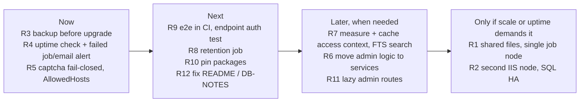

# 10 — Technical Risks and Recommendations

This is an assessment of the code at commit `18b46e2`. Recommendations are **proposals only**. Nothing in this
document set changed code, schema, configuration or scripts.

Rating: **High**: likely to cause an incident or block growth. **Medium**: real cost or risk, can be planned.
**Low**: hygiene.

## 1. Summary

| # | Area | Risk | Rating |
|---|---|---|---|
| R1 | Scalability | API is bound to a single server (jobs, files, rate limiter, cache) | High (if load or availability needs grow) |
| R2 | Availability | Single IIS server and single SQL Server; releases stop the app pools | High |
| R3 | Operations | No backup before schema upgrades; no schema version record | High |
| R4 | Observability | Logs only in local files; no metrics, alerts or tracing | Medium |
| R5 | Security | Open audit items: captcha fails open on config fault, IP-based anonymous rate limit, browser-only idle timeout, `AllowedHosts: *` | Medium |
| R6 | Architecture | Business and data logic in large controllers; Application layer tied to EF Core | Medium |
| R7 | Performance | Access context rebuilt with many queries on every request; `LIKE` search on KB | Medium |
| R8 | Data growth | No retention for notifications, audit logs, refresh tokens, rate counters | Medium |
| R9 | Quality | No front-end unit tests; e2e not in CI; no API integration tests | Medium |
| R10 | Supply chain | Floating NuGet versions, no lock file; import tool and Npgsql in production build | Low–Medium |
| R11 | Frontend | Initial bundle over budget; very large page files | Low |
| R12 | Documentation | README status and DB-NOTES service names are outdated | Low |

## 2. Scalability and availability

### R1: Single-server design

| Element | Why it ties the API to one server | Evidence |
|---|---|---|
| Hangfire server in the API process | Every API instance with `Jobs:Enabled=true` also runs jobs (the code notes "run the worker in exactly one place") | `Infrastructure/DependencyInjection.cs` line 84–85 |
| Attachments on local disk | `LocalFileStore` is the only `IFileStore` | `Files/LocalFileStore.cs` |
| Rate limiter | ASP.NET in-memory partitions, per process | `Program.cs` 70–80 |
| `IMemoryCache` | Per process | `DependencyInjection.cs` line 60 |
| Data Protection keys | **Already shared** (SQL Server key ring) | `Security/KeyRing.cs` |
| Sessions | **Already shared** (refresh tokens in SQL) | `TokenService` |

**Recommendation:**
- Before adding a second web server:
  - set `Jobs:Enabled=false` on all but one node, or move jobs to a Windows service;
  - move attachments to a shared store (an SMB share or object storage behind `IFileStore`);
  - accept per-node rate limits or move them to SQL or Redis.
- The database-side design is already concurrency-safe: `READPAST` queues, `HOLDLOCK` counters and unique-index dedupe.

### R2: Single points of failure and release downtime

- One IIS server and one SQL Server. `04_logins.sql` assumes SQL Server on the same machine.
- `Install-Ccs.ps1` stops `CcsWeb` and `CcsApi`, mirrors files and starts again, so every release causes a short outage.

**Recommendation:** decide the target availability first. If it is above one server, plan a second IIS node behind
a load balancer (after R1) and SQL Server Always On or log shipping. If it is not, document a maintenance window
and keep the current simple model. That is a valid choice for this size.

## 3. Operations

### R3: Upgrades without a safety net

- `05_upgrades.sql` runs on every install. It is idempotent, but nothing records which version a database is on,
  and the installer takes no backup first.
- **Recommendation:**
  - add a "pre-upgrade backup" step, at least `BACKUP DATABASE … COPY_ONLY`, to the installer or to the runbook;
  - add a small `ccs.schema_version` table written by the upgrade script;
  - keep the idempotent style, which suits this deployment model.

### R4: Observability

- Logs live only in `C:\CcsData\logs`. Hangfire failures, email failures (`notifications.status='failed'`) and SLA job
  errors raise no alert. There are no metrics.
- **Recommendation:**
  - add an external uptime check on `/api/health`;
  - forward Serilog to a central sink (Seq, Elastic or Azure Monitor);
  - add a daily check (or a Hangfire job) that reports failed jobs and failed emails to admins;
  - consider OpenTelemetry for request timing.

## 4. Security (from this review and the audit status in [06](06-Security-Architecture.md#9-status-of-the-security-audit-findings))

| Item | Risk | Recommendation |
|---|---|---|
| Captcha fails open when the secret cannot be opened (`CaptchaVerifier` lines 63–66) | A key-ring problem silently switches captcha off | Fail closed, or alert admins loudly; the warning is only in the log today |
| Anonymous rate limit by IP (M-06) | Users behind one NAT share limits; distributed attacks bypass them | Keep the per-account database lockout (strong); add per-identifier limits on `sign-in`, `forgot-password`, `signin-code` |
| Idle timeout only in the browser (M-04) | A stolen refresh cookie stays valid up to the longest sign-in time | Add a server-side idle check on refresh (last use plus idle limit) |
| `AllowedHosts: "*"` (I-04) | Host header spoofing in generated links | Set the real host names in production configuration |
| Authorization by convention | Endpoints call `Need(...)` / `AccessService` themselves; a forgotten call is not caught by the framework | Add a test that lists every action and checks it is anonymous by design or calls the access layer (or add policy-based attributes per area) |
| Data at rest | No TDE or backup encryption set by the scripts | Decide with the data owner; at least encrypt backups |

Already strong, and worth keeping:
- refresh-token rotation with reuse detection;
- session checks on every request;
- lockout counted in a single SQL `UPDATE`, with the same answers for unknown accounts;
- fail-closed virus scan with a magic-byte check;
- least-privilege SQL login with an append-only audit log;
- the CSP;
- the access parity test.

## 5. Architecture and code quality

### R6: Logic in controllers

- 16 of the 27 controller files use `CcsDbContext` directly. `SettingsController.cs` (993 lines), `AdminController.cs`
  (934) and `CatalogAdminController.cs` (709) hold validation, rules and persistence together.
- `ICcsDbContext` exposes `DbSet<T>`, so the Application layer depends on EF Core.
- **Recommendation:** no big rewrite. When a controller area changes next, move its rules into an Application
  service (as the ticket area already does) and add unit tests for them. Start with user and place administration,
  where most authorization rules live.

### R7: Per-request cost and search

- `AccessService.BuildContextAsync` runs about 7–9 queries (profile, roles, type, permissions, teams, placements,
  scopes, sometimes the organization tree and shared access). `AccountGateMiddleware` adds a session check and a
  status/MFA query. These run on **every** API call.
- KB search uses `Contains` (SQL `LIKE '%x%'`), while a full-text index exists and goes unused.
- **Recommendation:** measure first (log the timing of `BuildContextAsync`). If it matters, cache the context per user
  for a short time and invalidate it on role or placement changes. For the KB, use `CONTAINS` / `FREETEXT` when
  FTS is installed.

### R8: Data growth

- No clean-up job exists for `notifications` (in-app and email rows), `audit_logs`, `refresh_tokens` (revoked and expired),
  `rate_counters`, `signin_codes` or `auth_codes`.
- **Recommendation:** agree retention periods (audit logs may have legal needs), then add one Hangfire clean-up job.
  The audit log must stay append-only for the app login, so its archiving should run under a separate maintenance login.

### R9: Test coverage gaps

| Layer | Today | Gap |
|---|---|---|
| Domain rules | Good (11 test files) | – |
| Application services with a database | Parity test only | No tests of `TicketService`, `SlaService`, `LifecycleService` against SQL |
| API | CI smoke tests after install | No per-endpoint authorization tests in CI |
| Front end | None | No unit tests; Playwright suite exists but is not run in CI |

**Recommendation:**
- run the Playwright suite in the `deploy-test` job, which already has a full installation;
- add a few service tests on a throwaway SQL database, as the audit did with `CCS_AuditTest`.

### R10: Dependencies

- Floating versions (`10.0.*`, `9.*`, `1.8.*`, `4.*`) and no `packages.lock.json`, so two builds of the same commit can
  differ.
- `Npgsql` and `SupabaseImport.cs` ship inside the production API, although they are used only once for migration.
- **Recommendation:** pin versions (or enable `RestorePackagesWithLockFile`). After the final migration, move the
  import into a separate tool project.

### R11: Frontend size

- The initial bundle is slightly over the 950 kB warning budget. 33 routes load at start.
- Page files hold many components (`settings-pages.ts` 1,842 lines).
- **Recommendation:** make more admin routes lazy (`loadComponent`). Split the largest page files by screen.

## 6. Documentation drift

| Document | Statement | Reality in code |
|---|---|---|
| `README.md` | ".NET code has not been compiled yet" | Built and tested in CI on every push |
| `README.md` | Stages 3, 4, 7, 8: admin screens, cancellation, links, uploads, reports, KB "not done / not started" | Implemented (see [08](08-Ticket-Workflow.md), [07](07-API-Integration.md)) |
| `README.md` | Two IIS sites with ARR proxying `/api` | Default is the `/api` IIS application in one site; separate site optional; no proxy |
| `README.md` | "61 tables" / "50 tables" | 70 tables (63 `ccs` + 7 `dbo`) |
| `docs/DB-NOTES.md` | Rules "enforced by" `UserAdminService`, `SlaAdminService`, `KbService`, `TeamService` | These classes do not exist; the logic is in controllers (`AdminController`, `CatalogAdminController`, `ContentAdminController`, `PeopleController`) |
| `docs/DB-NOTES.md` | Each moved rule "gets a unit test when its service is built" | Delete-order rules have no dedicated tests |

**Recommendation:** treat `docs/architecture/` as the current reference. Update the README status table, and
point `DB-NOTES.md` to the real classes.

## 7. Suggested order

